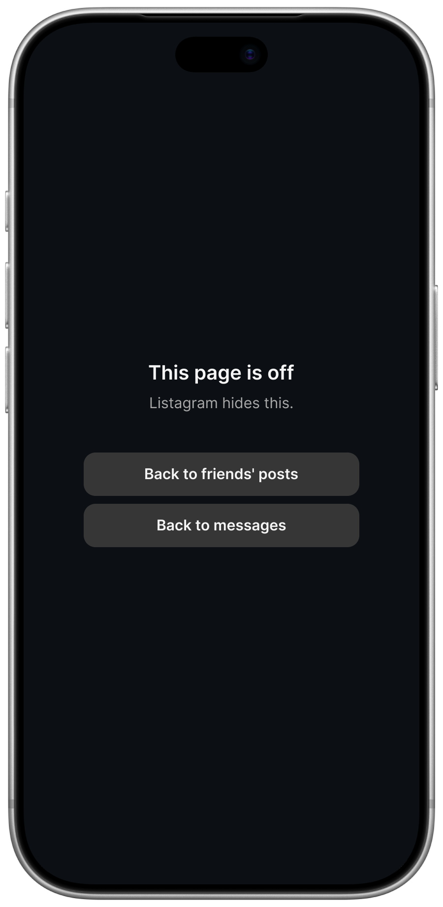

  <picture>
    <source media="(prefers-color-scheme: dark)" srcset="design/logo-dark.png">
    
  </picture>

  

Instagram without the scrolling.

## What it hides
- Reels feed and swiping between reels
- Explore and search
- Recommended home feed
- Suggested accounts

Messages, stories, and friends' posts and reels still work.

## Install on iPhone
1. Install [Userscripts](https://apps.apple.com/us/app/userscripts/id1463298887) and turn it on in Safari's extension settings.
2. Open [this install link](https://raw.githubusercontent.com/qiz-li/listagram/main/src/listagram.user.js) in Safari.
3. Tap the extensions icon, choose Userscripts, and install the script.
4. Open instagram.com in Safari.

Not affiliated with or endorsed by Instagram, Meta or Apple.
